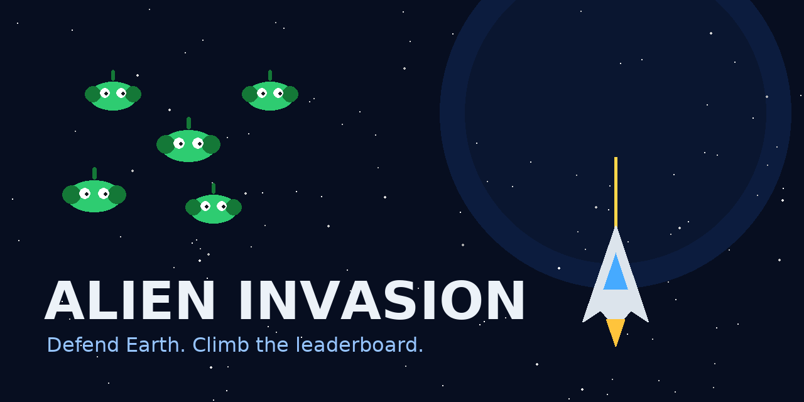
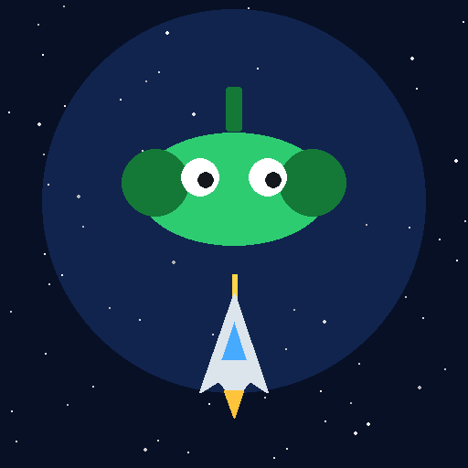

<p align="center">
  
</p>

<p align="center">
  
</p>

<h1 align="center">Alien Invasion</h1>

<p align="center">
  A Pygame arcade game. Enter your name, defend Earth from a descending alien fleet, and save your score.
</p>

<p align="center">
  
  
  
</p>

## Play

```bash
python -m venv .venv
source .venv/bin/activate
pip install -r requirements.txt
python alien_invasion.py
```

On Windows, activate the virtual environment with `.venv\Scripts\activate`.

The game opens on a name screen. Type your name and press Enter to start. Your name and score are written to `scores.json` when the game ends, or if you quit during a run. That file stays on your machine and is not committed.

## Controls

<p align="center">
  
  
  
  
</p>

| Key | Action |
| --- | --- |
| Left / Right | Move the ship |
| Space | Fire |
| P or Play | Start another game after game over |
| Q | Quit and save the current score |
| Enter | Confirm your name |

You start with 3 ships. Clearing a fleet starts the next level, and the aliens get faster. Each alien is worth more points as the level rises.

## Scores

Finished games are stored as a JSON list, highest score first:

```json
[
  {
    "name": "Adnan",
    "score": 3000
  }
]
```

`scores.example.json` shows the same shape. The in-game board lists the top five saved scores.

## Project layout

```text
alien_invasion.py    Game loop, name entry, and collisions
setting.py           Screen, speed, and scoring settings
ship.py              Player ship
bullet.py            Shots fired by the ship
alien.py             Alien fleet sprites
button.py            Play button
game_stats.py        Lives, score, and JSON storage
scoreboard.py        Heads-up display and leaderboard
Image/               Ship artwork
assets/              Repository icon, banner, and key icons
```
